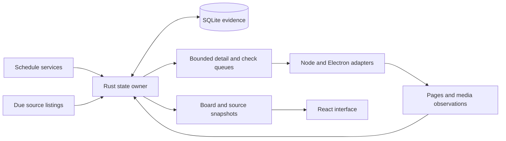

# Rust pipeline

The pipeline uses one Rust state owner and one SQLite connection. Rust owns schedule ingestion, source admission, matching, publication, probe queues, playback selection, proof retention, persistence, and inventory projection.

Electron still owns browser windows and video playback. The TypeScript coordinator dispatches external operations and returns their results to Rust. It does not choose polling deadlines, eligible games, retry priorities, or retained feeds.

## Ownership

| Code | Responsibility |
| --- | --- |
| `native/collector/src/pipeline/mod.rs` | State transitions, schedule publication, commands, deadlines, and lifecycle |
| `pipeline/schedule.rs` | Schedule HTTP requests, concurrency, parsing, history, and season membership |
| `pipeline/discovery.rs` and `sources.rs` | Listing and detail admission, publication, and transport cooldowns |
| `pipeline/matching.rs` and `domain.rs` | Event identity, game matching, calendar rules, and ownership |
| `pipeline/probes.rs` and `feeds.rs` | Probe admission, fairness, completed outcomes, and media proof |
| `pipeline/sessions.rs` | Viewer selection, authorization, generations, and recovery |
| `pipeline/store.rs` | SQLite reads, writes, ownership, and persisted evidence |
| `pipeline/views.rs`, `catalog.rs`, and `catalog_plan.rs` | Inventory, catalog admission, and browser collection plans |
| `pipeline_api.rs` | Native addon boundary and transfer of the repository connection |
| `lib/football/runtime/coordinator.ts` | External-operation dispatch, cancellation, reply delivery, and the timer returned by Rust |
| `lib/football/runtime/native-schedule.ts` | Native schedule adapter and progress delivery |
| `desktop/` and `lib/playback/` | Browser acquisition, media playback, and observations returned to the pipeline |

Paths beginning with `pipeline/` are relative to `native/collector/src/`.

## State transitions

`Pipeline::step` receives a command, timer wake, progress report, or completed operation. It returns replies, operations to launch, operations to cancel, and the next wake deadline. Each asynchronous operation carries a token with its epoch and health revision. A completion cannot establish proof after its owner has changed.

The host applies a batch after the native call returns. It sends progress and completions through the same input queue. This prevents a synchronous callback from reentering Rust while Rust holds mutable state.

The store transfers its connection into the pipeline when the coordinator starts. Repository access then uses the same owner. The migration retains the existing SQLite schema and does not run a database migration.

On Windows, Rust allocations use mimalloc. This setting belongs to the addon and does not replace Electron's allocator. Fixed regexes share their execution caches. Matching preparation and source-candidate indexes live within a projection, so a later publication starts from current evidence.

## Collection limits

Listing discovery admits four requests globally and one per source family. Detail discovery admits eight requests globally and two per host. Each detail pass admits at most eighty observations. Further passes continue pending work without exceeding the active limits.

Source listings can cover an entire provider. The pipeline fetches them when their polling policy permits, then matches individual events against the schedule. Detail acquisition and media checks use eligible games. Automatic feed work covers live events and scheduled events on today or tomorrow in America/Chicago, subject to fresh schedule evidence and provider rules.

Ten working feeds per game is a discovery priority target. It does not discard published backups. Different source labels for the same checked route count as one working feed.

Media checks use the configured probe capacity. The ordinary idle limit is sixteen, and viewing reduces it to four. The pending queue has a limit of 256. A checking indicator can describe a due route waiting outside that admitted queue, so the displayed checking count can exceed active plus queued work.

## Warm and cold state

Completed checks and working-feed records survive restart. The pipeline validates their provider identity and game ownership before reuse. A saved working hint alone does not establish current advancing-video proof. Queued and active jobs do not survive restart.

Advancing-video proof stays fresh for thirty minutes. Working routes become eligible for a maintenance check after twenty-five minutes. Failed checks normally retry after five minutes. Incomplete checks use thirty-second, one-minute, two-minute, five-minute, and ten-minute delays. Transport cooldowns can delay acquisition further.

Schedule evidence is fresh for ninety seconds. A restart can display saved schedule and source data while fresh requests run. Reused evidence must still satisfy its ownership, age, and lifecycle rules. A final game retains its selected route through the configured retention period and receives no new automatic media checks.

## Verification

Frozen fixtures under `tests/fixtures/rust-pipeline-*.json` and `tests/fixtures/rust-browser.json` record the pre-migration TypeScript results. Their generation scripts require an explicit baseline directory. They must not derive expected results from the Rust wrappers being checked.

Public coordinator tests cover discovery, queue fairness, restart restoration, reassignment, viewer ownership, and publication boundaries. Native tests cover the state owner, store, schedule client, matching, and projections. Electron verification must attach to the running development app and disconnect without closing it.
